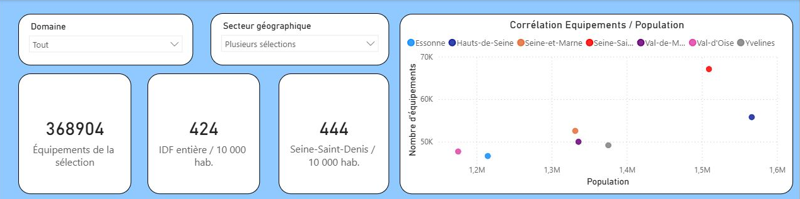

# Équipements en Île-de-France - Power BI

Pendant mon stage à la Préfecture de la Seine-Saint-Denis, j’ai conçu un rapport pour comparer les équipements des départements et communes franciliens : situation en 2024 et évolution depuis 2019.

**Outils :** Power BI, Power Query, DAX, SQLite, DBeaver et Talend Open Studio.

## Aperçu du projet

[Voir l’image en grand format](docs/apercu.png)

## Télécharger et ouvrir

1. Installe [Power BI Desktop](https://powerbi.microsoft.com/desktop/) si besoin.
2. [Télécharge le projet en ZIP](https://github.com/ArilesD/rapport-stage-power-bi/archive/refs/heads/main.zip) et fais **Extraire tout**.
3. Ouvre le dossier extrait et double-clique sur **OUVRIR.cmd**, ou ouvre directement **Equipements-IDF-Stage.pbix**.

Les données sont déjà enregistrées dans le rapport : tu peux parcourir les pages et utiliser les filtres dès l’ouverture.

## Explorer le rapport

| Page | Ce qu’elle montre |
| --- | --- |
| Départements - 2024 | Volumes, densités et répartition des équipements par domaine |
| Évolution des départements | Comparaison de 2019 et 2024 |
| Communes - 2024 | Comparaisons communales avec la population et les salaires disponibles |
| Évolution des communes | Évolution des équipements par commune |
| Communes du 93 | Comparaison des communes de Seine-Saint-Denis |

Paris est masqué à l’ouverture pour mieux lire les écarts entre les autres départements. Tu peux le sélectionner dans **Secteur géographique**.

L’évolution compare seulement les équipements comparables entre 2019 et 2024. L’enseignement couvre ici l’enseignement agricole ; le tourisme est limité aux types suivis sur les deux années. Les densités dépendent du modèle de population du stage, dont le millésime n’est pas documenté.

## Mon travail

- Préparer et harmoniser les données avec Power Query.
- Concevoir la base SQLite dans DBeaver et charger les tables avec Talend Open Studio.
- Relier les tables dans Power BI, puis créer les mesures DAX et les graphiques.

## Sources et limites

Les équipements viennent de la [Base permanente des équipements de l’Insee](https://www.insee.fr/fr/metadonnees/source/operation/s2216/bases-donnees-ligne), et le référentiel communal de l’[API Géo](https://geo.api.gouv.fr/). Les salaires communaux datent de **2014** : [source Insee republiée sur Kaggle sous CC0](https://www.kaggle.com/datasets/etiennelq/french-employment-by-town).

La population utilisée par le modèle inclut aussi douze codes communaux absents du référentiel. Les densités restent celles du modèle de stage et se lisent avec cette réserve ; elles ne mesurent ni la capacité d’accueil ni les temps de trajet.

L’actualisation des données nécessite la base SQLite du stage et sa connexion ODBC. Les cartes Bing Maps dépendent des paramètres et de leur prise en charge dans Power BI. [Documentation des cartes](https://learn.microsoft.com/fr-fr/power-bi/visuals/power-bi-visualization-filled-maps-choropleths).
